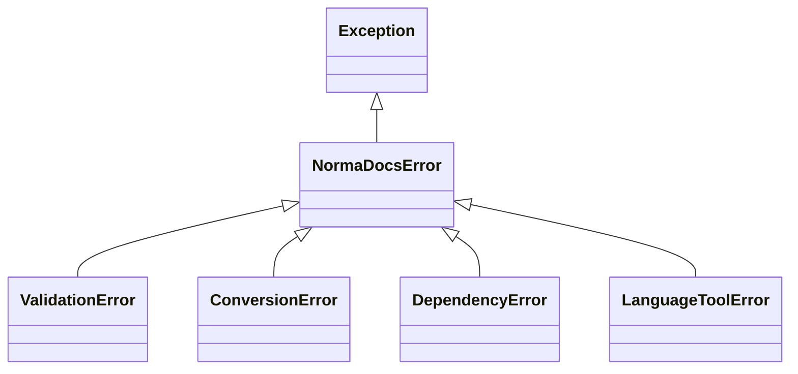

# Data Models

The refactor introduces a cleaner state management pattern for the application.

## `ConvertOptions`

A purely functional, immutable data class that replaces the scattered argument passing from the Typer CLI.

```python
from dataclasses import dataclass
from pathlib import Path
from typing import Optional

@dataclass(frozen=True)
class ConvertOptions:
    input_file: Path
    output_dir: Path
    format: str
    style: str
    bibliography: Optional[str] = None
    csl: Optional[str] = None
    language_tool: Optional[str] = None
    lt_host: str = "http://localhost"
    lt_port: int = 8010
    lt_stop_on_error: bool = False
    lt_docker: bool = False
    lt_keep_alive: bool = False
    lt_report: Optional[Path] = None
    lt_enabled_rules: Optional[str] = None
    lt_disabled_rules: Optional[str] = None
    lt_ignore_words: Optional[str] = None
    lt_strict: bool = False
    lt_no_spelling: bool = False
    verify_apa: bool = True
    apa_strict: bool = True
    apa_report: Optional[Path] = None
```

## `Exceptions`



- **`NormaDocsError`**: Base exception.
- **`ValidationError`**: Bad inputs or missing files.
- **`ConversionError`**: Pandoc or formatting failures.
- **`DependencyError`**: Missing system binaries (e.g. Pandoc).
- **`LanguageToolError`**: Errors parsing rules or connecting to LT Docker.
